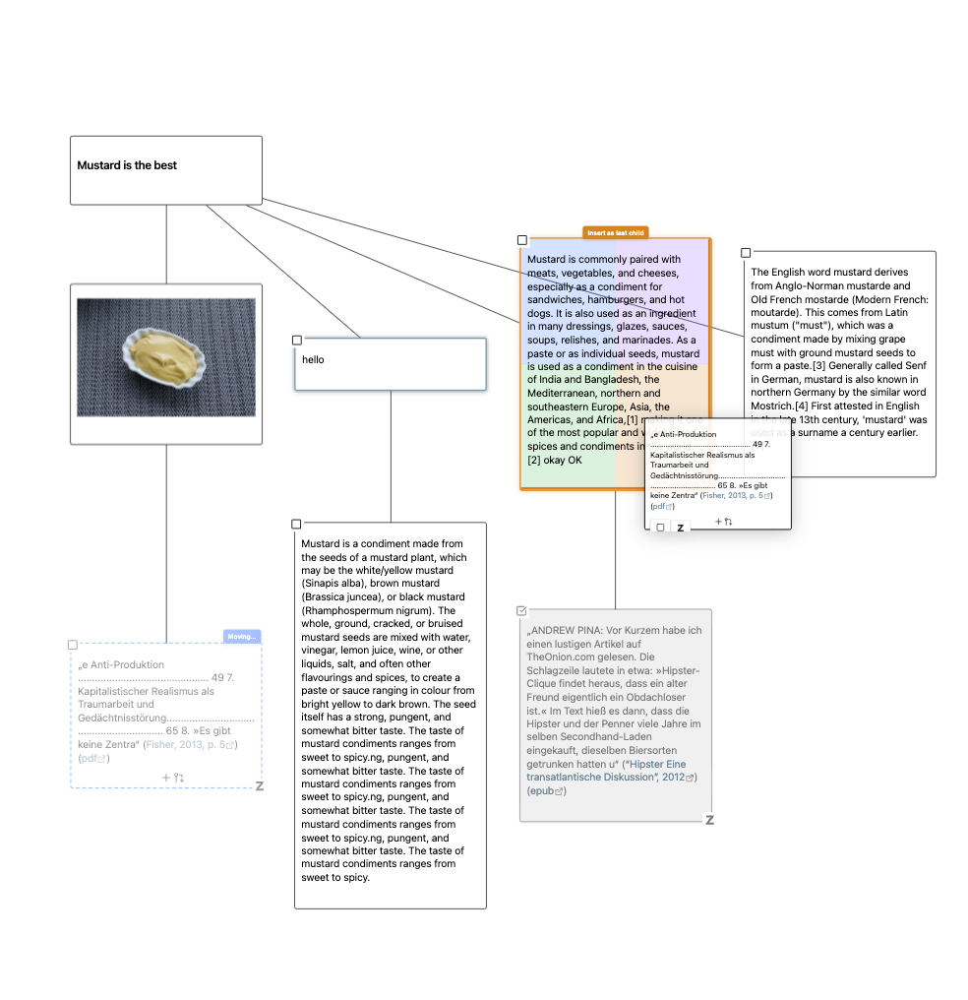
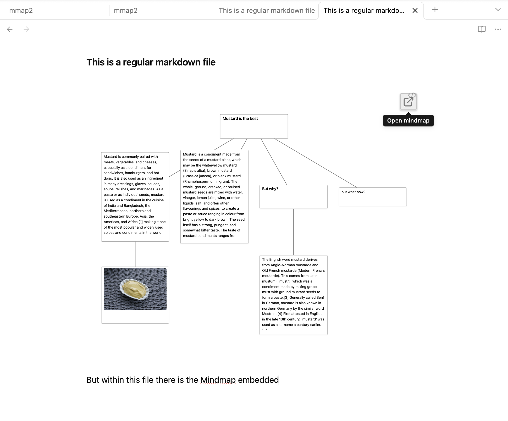

# Excerpt-Outline-Mindmap-Editor

Excerpt-Outline-Mindmap-Editor is an Obsidian plugin for working with Markdown outlines as visual mindmaps. It is built around a simple drag-and-drop workflow, that basically rearranges the underlying Markdown bullet points.

It is especially useful for literature excerpting, research notes, and other situations where a spatial view makes it easy to navigate and structure quotes and thoughts. For this reason every node can also be greyed out with checkboxes.



---

## Core idea

A node in the mindmap is just a Markdown list item. Moving a node changes its position and indentation in the file. There is no custom database, no proprietary mindmap file, and no hidden document format.

This keeps your notes readable in Obsidian's normal editor and compatible with other outline-based tools such as [Lineage](https://github.com/ycnmhd/obsidian-lineage).

---

## Drag and drop

The main interaction is dropping one node onto another. The target node is split into four drop zones:

- **Upper left:** insert as sibling before the target
- **Upper right:** insert as sibling after the target
- **Lower left:** insert as first child of the target
- **Lower right:** insert as last child of the target

```text
+-------------------+-------------------+
|   Upper Left:     |   Upper Right:    |
|  Sibling Before   |   Sibling After   |
+-------------------+-------------------+
|   Lower Left:     |   Lower Right:    |
|   First Child     |    Last Child     |
+-------------------+-------------------+
```

When you move a node, its whole subtree moves with it. The result is written back to the Markdown outline, so the visual operation and the document structure stay in sync.

---

## Quick start

Requires Obsidian 1.8.7 or newer. Desktop and mobile.

1. Create a Markdown file, either empty or with an outline.
2. Open the file as a mindmap:
   - Select the three-dot menu in the editor and choose **Open as mindmap**.
   - Or right-click the file in the file explorer and choose **Open as mindmap**.
3. Build or restructure the outline visually.

All changes are written back to the Markdown file. You can switch between the mindmap and the normal Markdown editor at any time.

---

## Markdown data

Mindmap files are regular Markdown files made from indented list items:

```markdown
- Parent node
  - Child node
    - Grandchild node
- Another parent node
```

Task list items are supported too:

```markdown
- [ ] Unchecked task
- [x] Checked task
```

Markdown headings can be used to group separate trees in the same file. A heading creates a visual frame around the tree below it:

```markdown
# First tree
- Parent node
  - Child node

## Nested section
- Another parent node
```

Headings stay as normal Markdown headings in the file and are rendered with your current Obsidian theme in the mindmap view.

If the file contains non-outline content outside list items, the mindmap view may reject it as incompatible. Display settings such as layout, zoom, node width, and keyboard navigation mode are stored per file in the `excerpt-outline-mindmap` frontmatter key.

---

## What you can do

### Structure

- Move nodes with the four-zone drag-and-drop system.
- Add child and sibling nodes from hover controls or the context menu.
- Add a heading frame for a tree from a node's context menu with **Add heading for this tree**.
- Copy, cut, paste, duplicate, and delete nodes.
- Select multiple nodes by clicking with **Cmd**/**Ctrl** or **Shift**, or by drawing a selection box on empty canvas space.
- Delete only a node or delete its full subtree when children are involved.

### Editing

- Double-click a node, press **Enter**, or choose **Edit** in the context menu. **Edit** opens whatever the node holds: a drawing opens in its editor, anything else as text.
- Double-click a heading to edit its raw Markdown heading text, including the leading `#` characters.
- The editor is actually the full Obsidian editor.
- Newly created child and sibling nodes enter edit mode automatically.
- Markdown content renders inside nodes, including links, emphasis, images, SVGs, and other Obsidian-rendered content.
- A node is a single outline line, so hard line breaks inside one are not supported. Shift+Enter is refused, and multi-line text pasted into a node is joined with spaces.

### Tasks and sources

- Nodes using `- [ ]` and `- [x]` are recognized as tasks and can be toggled directly in the mindmap.
- Non-task nodes can optionally show a checkbox on hover and become task items when clicked.
- Checked nodes are visually muted.
- Nodes containing Zotero links show a Zotero badge for opening the source.

### Export

- Use the command **Export current mindmap to Canvas** to create an Obsidian Canvas from the active mindmap.
- The export creates text cards for all nodes, connects parent and child nodes, and keeps task nodes as Markdown task list items.

### Drawings

- Use **Add drawing as child** or **Add drawing as sibling** in a node's context menu.
- Apple Pencil input uses real browser pressure samples, coalesced pointer events, tilt metadata, pointer capture, and palm rejection. Mouse and touch continue to work without a Pencil.
- Hold briefly at the end of a freehand stroke to straighten it. Lines and ellipses are fitted precisely; other strokes are simplified and smoothed without being forced into a standard shape.
- A drawing node is a normal Obsidian SVG embed such as `![[Idea drawing.svg]]`.
- The SVG attachment contains both the visible vector preview and versioned editable drawing data in its SVG `<metadata>` element. The parent Markdown file therefore stays readable, and the image remains visible even when the plugin is disabled.
- **Edit** on a drawing node reopens that metadata in the editor; on a text node the same entry edits the text. Everything stays local to the vault.
- Closing the editor with unsaved strokes asks whether to save, discard, or keep editing. Cancel, Escape, and clicking outside all go through that question.

### Excalidraw drawings

If the [Excalidraw](https://github.com/zsviczian/obsidian-excalidraw-plugin) plugin is installed and enabled, the node context menu additionally offers **Add Excalidraw drawing as child** and **Add Excalidraw drawing as sibling**. Without Excalidraw these entries do not appear, and the built-in drawing editor above is unaffected either way.

- New drawings follow Excalidraw's own settings for the drawing folder and the file format, so they behave like any other drawing in your vault. The filename is derived from the node text, as it is for the built-in drawings.
- The node embeds the drawing as a normal Obsidian embed such as `![[Idea drawing.excalidraw]]`, which Excalidraw renders in the mindmap like it does anywhere else.
- **Edit** on such a node opens Excalidraw's own editor in a new tab. The mindmap re-renders that node shortly after the drawing is saved, without touching the rest of the map.

### Navigation

- Pan with two fingers on a trackpad or by holding the middle mouse button.
- Zoom with a trackpad pinch gesture or **Ctrl** + mouse wheel.
- Use **Fit to view** in the toolbar to refit the whole mindmap.
- Navigate selected nodes with the arrow keys.
- Choose spatial or hierarchical keyboard navigation in **General settings**.

### Toolbar

- **Undo** and **Redo**
- **Fit to view**
- Zoom menu
- Layout options
- Node width options
- General settings

### Keyboard shortcuts

- **Arrow keys** navigate through nodes.
- **Enter** edits the selected node.
- **Cmd/Ctrl + Arrow Down** adds a last child to the selected node.
- **Cmd/Ctrl + Arrow Left** adds a sibling before the selected node.
- **Cmd/Ctrl + Arrow Right** adds a sibling after the selected node.
- **Cmd/Ctrl + C** copies the selected node or selected nodes.
- **Cmd/Ctrl + X** cuts the selected node or selected nodes.
- **Cmd/Ctrl + V** pastes onto the currently selected node.
- **Delete**/**Backspace** deletes the selected node or selected nodes.

---

## Embed a mindmap in another note

Use a `mindmap-eome` code block with exactly one Markdown filename:

````markdown
```mindmap-eome
mindmap.md
```
````

The embedded mindmap is shown as a full read-only overview. Hover the top-right corner of the embed and select the icon to open that file in the regular editable mindmap view.

Only the filename belongs inside the code block. Options, extra text, and multiple files are not supported.



---

## Mobile support

The plugin offers mobile support. You can navigate, edit, and restructure your mindmaps using touch gestures or Apple Pencil. A double tap edits a node, matching desktop double-click. Press and hold opens the desktop-style context menu; moving after that hold picks the node up. Pinch and pan gestures never start a node drag.

---

## Libraries

- [Cytoscape.js](https://js.cytoscape.org/) for graph rendering
- [Dagre](https://github.com/dagrejs/dagre) for automatic hierarchical layout
- [Simple Whiteboard](https://github.com/ludovicm67/simple-whiteboard) for drawing tools and object editing
- [perfect-freehand](https://github.com/steveruizok/perfect-freehand) for pressure-sensitive vector strokes

Thanks to the developers.

---

## Inspiration

- [Lineage](https://github.com/ycnmhd/obsidian-lineage)
- [MarginNote](https://www.marginnote.com/)

---

## Roadmap

- Export and print options  

---

## Disclaimer

I vibecode my plugins—and the scope of this work exceeds my programming skills. Because of this, there is always a residual risk when using them. I do this primarily to bridge certain gaps in my own workflow. Should these plugins ever become obsolete because a professional developer used them as inspiration to code something truly solid and sophisticated, I would be absolutely thrilled.
